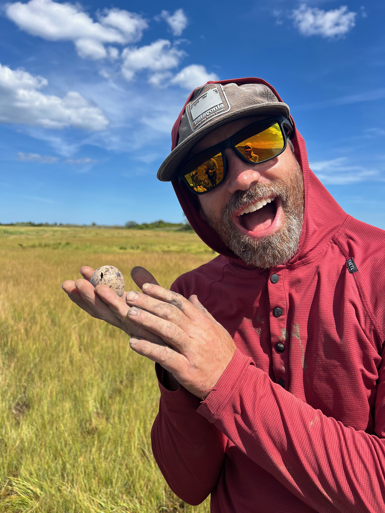
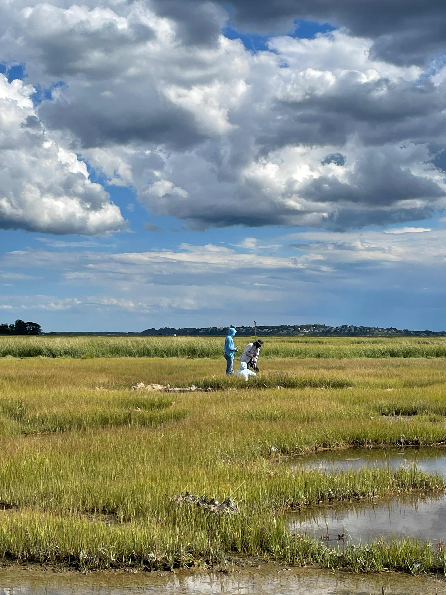
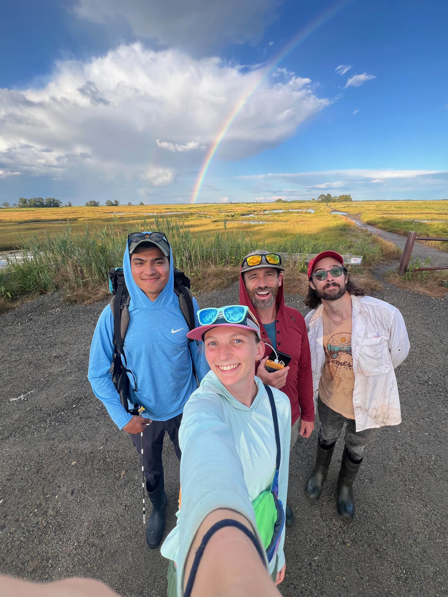

## Colleagues

::: {.grid}

::: {.g-col-12 .g-col-md-5}
{fig-alt="I love being in the field" style="border-radius: 10px; width: 100%; aspect-ratio: 4 / 3; object-fit: cover; box-shadow: 0 4px 12px rgba(0,0,0,0.08); margin-bottom: 0.75rem;"}

**Contact & Profiles**  

- **Email:** [jvineis@gmail.com](mailto:jvineis@gmail.com)  
- **GitHub:** [@jvineis](https://github.com)  
- **Google Scholar:** [Profile](https://scholar.google.com)  
- **ORCID:** [0000-0002-4101-1449](https://orcid.org)  
- **CV:** [Download PDF](files/Vineis-CV.pdf)
:::

::: {.g-col-12 .g-col-md-7}
### Joseph H. Vineis, PhD
*Scientific Informatics Project Leader | The Ecosystems Center, Marine Biological Laboratory*

I study microbial genomes at the molecular level to understand how microbial communities regulate the biogeochemistry of coastal and marine ecosystems. My research integrates high-throughput multi-omics (genome-resolved metagenomics, metatranscriptomics, and amplicon sequencing) with environmental and biogeochemical data across bacteria, archaea, microeukaryotes, and mobile genetic elements.

#### Education & Appointments
* **Scientific Informatics Project Leader:** Ecosystems Center, Marine Biological Laboratory
* **Postdoctoral Research (2022–2024):** Department of Geosciences, Princeton University (*Ward Lab*)
* **PhD in Ecology, Evolution, and Marine Biology (2022):** Northeastern University (*Bowen Lab*)
* **Senior Research Assistant (2010–2022):** Josephine Bay Paul Center / Keck Facility, Marine Biological Laboratory
* **MS in Molecular Ecology (2010):** SUNY College of Environmental Science and Forestry (*Horton Lab*)
* **BA in Biology (2002):** University of Vermont
:::

:::

---

## Lab & Fieldwork Team

::: {.grid}

::: {.g-col-12 .g-col-md-6}
{fig-alt="Field team working together in the marsh" style="border-radius: 10px; width: 100%; aspect-ratio: 4 / 3; object-fit: cover; box-shadow: 0 4px 12px rgba(0,0,0,0.08);"}
:::

::: {.g-col-12 .g-col-md-6}
### Collaborative Field & Computational Science
*Marine Biological Laboratory · Woods Hole, MA*

I work with biogeochemists, hydrologists, plant physiologists, and bioinformaticians to integrate environmental measurements with genome-resolved microbial dynamics.

* **Prospective connections:** I welcome inquiries from students and visiting researchers interested in estuarine 'omics, bioinformatics, and wetland methane cycling.
* **Get in Touch:** Send a brief note about your research interests via [email](mailto:jvineis@gmail.com).
:::

:::

::: {.grid}

::: {.g-col-12 .g-col-md-6}
{fig-alt="Field team standing together in the high marsh" style="border-radius: 10px; width: 100%; aspect-ratio: 4 / 3; object-fit: cover; box-shadow: 0 4px 12px rgba(0,0,0,0.08);"}
:::

::: {.g-col-12 .g-col-md-6}
### Cross-Institutional Marsh Sampling
*Plum Island Ecosystems & Coastal Wetlands*

Our fieldwork brings together researchers across institutions to track greenhouse gas fluxes, porewater chemistry, and microbial community structure across tidal gradients.

* **Fieldwork & Training:** Undergraduate interns, graduate students, and visiting collaborators participate in seasonal coring and gas flux campaigns.
* **Data Integration:** Field observations directly inform our metagenomic and metatranscriptomic analyses in Woods Hole.
:::

:::

---

## Key Collaborators & Mentors

| Collaborator / Mentor | Affiliation | Collaborative Focus |
| :--- | :--- | :--- |
| **[Zoe G. Cardon](https://www.mbl.edu)** | Ecosystems Center, Marine Biological Laboratory | Plant–microbe interactions and methane cycling in *Typha angustifolia* brackish marshes |
| **[Jennifer L. Bowen](https://northeastern.edu)** | Marine Science Center, Northeastern University | Salt marsh nitrogen enrichment, chemolithoautotrophy, and Plum Island Ecosystems (PIE) LTER |
| **[Bess B. Ward](https://geosciences.princeton.edu)** | Department of Geosciences, Princeton University | Diatom, dinoflagellate, and parasite succession in simulated ocean upwelling mesocosms |
| **[A. Murat Eren (Meren)](https://merenlab.org)** | Helmholtz Institute / University of Oldenburg | Metapangenomics, Minimum Entropy Decomposition (MED), and [Anvi'o](https://anvio.org) platform development |
| **[Hilary G. Morrison](https://www.mbl.edu)** & **[Mitchell L. Sogin](https://mbl.edu)** | Marine Biological Laboratory | Mobile genetic elements, *Bacteroides* genome variants, and high-throughput sequencing methods |
| **[Anne E. Giblin](https://mbl.edu)** | Ecosystems Center, Marine Biological Laboratory | Coastal biogeochemical rate measurements and salt marsh sediment respiration |
