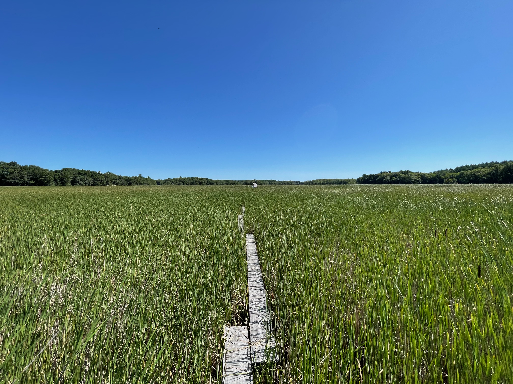
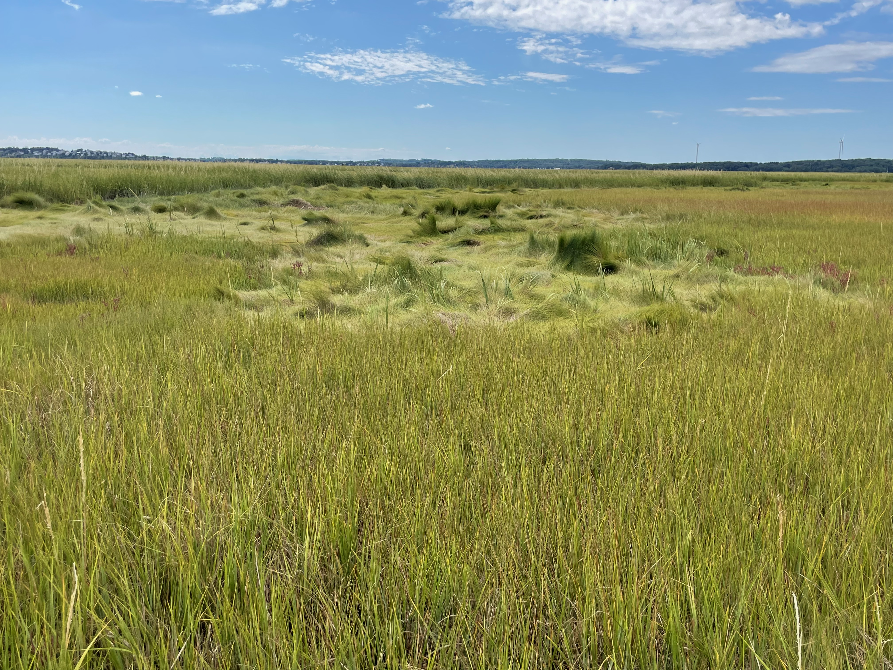
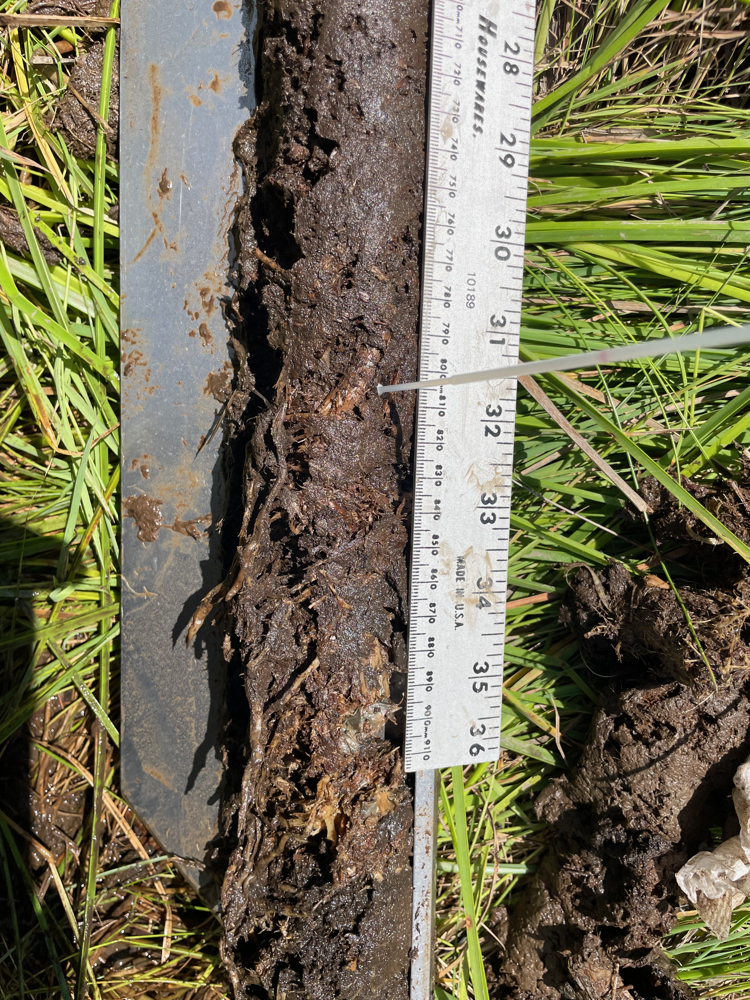
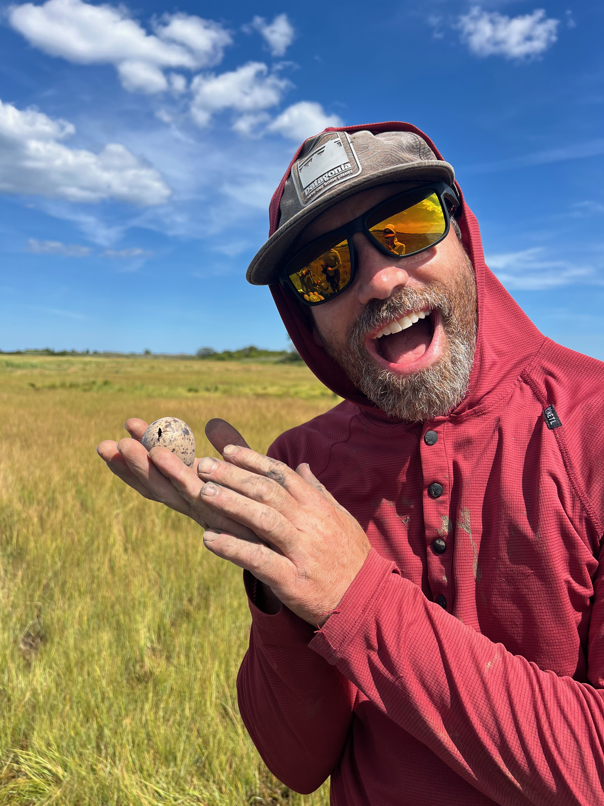

## Overview

My research investigates the molecular mechanisms driving interactions between microbial communities and their environments. By coupling high-throughput multi-omics (genome-resolved metagenomics, metatranscriptomics, and amplicon sequencing) with biogeochemical rate measurements and environmental metadata, I work to uncover how bacteria, archaea, microeukaryotes, and mobile genetic elements regulate elemental cycling.

---

## Core Research Themes

::: {.grid}

::: {.g-col-12 .g-col-md-6}
### 1. Plant–Microbe Interactions & Methane Cycling
*Ecosystems Center, Marine Biological Laboratory (Cardon Lab)*

{fig-alt="Boardwalk extending through a Typha marsh" style="border-radius: 8px; width: 100%; aspect-ratio: 16 / 10; object-fit: cover; margin-bottom: 0.75rem;"}

Brackish and tidal marshes are critical hotspots for carbon storage and greenhouse gas flux. Working within marshes dominated by narrowleaf cattail (*Typha angustifolia*), I investigate the ecology and genomic potential of diverse methanogenic archaea and methanotrophic bacteria.

* **Key Questions:** How do wetland plants shape rhizosphere redox conditions and substrate availability for methane-cycling guilds?
* **Approaches:** Metagenome-assembled genomes (MAGs), metatranscriptomics, and paired porewater geochemistry.
:::

::: {.g-col-12 .g-col-md-6}
### 2. Coastal Nitrogen Enrichment & Carbon Sequestration
*Bowen Lab, Northeastern University & Plum Island Ecosystems LTER*

{fig-alt="Spartina salt marsh landscape" style="border-radius: 8px; width: 100%; aspect-ratio: 16 / 10; object-fit: cover; margin-bottom: 0.75rem;"}

Salt marshes buffer coastal waters against anthropogenic nutrient loading while sequestering "blue carbon" at high rates. My work examines how chronic nitrate enrichment restructures sediment microbial communities and shifts metabolic pathways between heterotrophic respiration, denitrification, DNRA, and chemoautotrophy.

* **Key Findings:** Elevated nitrate selects for abundant sulfur- and nitrogen-oxidizing chemolithoautotrophs capable of fixing $\text{CO}_2$, potentially offsetting sediment carbon losses.
* **Approaches:** Flow-through sediment reactors, genome-resolved metagenomics, and gene-centric expression profiling.
:::

::: {.g-col-12 .g-col-md-6}
### 3. Depth-Resolved Sediment Biogeochemistry
*Plum Island Ecosystems LTER & Marine Biological Laboratory*

{fig-alt="Surface of a salt marsh sediment core" style="border-radius: 8px; width: 100%; aspect-ratio: 16 / 10; object-fit: cover; margin-bottom: 0.75rem;"}

Vertical redox gradients across marsh sediments structure distinct microbial niches from the oxic/suboxic surface down into sulfidic and methanogenic deep horizons.

* **Key Focus:** Linking depth-stratified metagenomes and carbohydrate-active enzymes (CAZymes) to organic matter degradation and sulfur/nitrogen transformations.
* **Approaches:** Deep sediment coring, genome-resolved assembly, and functional gene profiling (*dsrB*, *nirS*, *nrfA*).
:::

::: {.g-col-12 .g-col-md-6}
### 4. Field Biogeochemistry, Upwelling & Pangenomics
*Marine Biological Laboratory & Princeton University (Ward Lab)*

{fig-alt="Joseph Vineis conducting fieldwork in the marsh" style="border-radius: 8px; width: 100%; aspect-ratio: 16 / 10; object-fit: cover; margin-bottom: 0.75rem;"}

Connecting field observations to fine-scale genomic resolution, my work spans coastal marsh sampling, planktonic microeukaryote succession during ocean upwelling events, and strain-level pangenomics.

* **Key Focus:** Diatom, dinoflagellate, and parasite dynamics in upwelling mesocosms, alongside metapangenomics and mobile genetic elements in *Bacteroides* and marsh sulfur-cyclers.
* **Tools:** [Anvi'o](https://anvio.org), custom Python/R pipelines, and 18S rRNA/metagenomic workflows.
:::

:::

---

## Computational & Analytical Toolkit

A central component of my work as a Scientific Informatics Project Leader is building reproducible workflows for complex environmental datasets:

| Domain | Methods & Frameworks |
| :--- | :--- |
| **Genome-Resolved 'Omics** | Short- and long-read metagenomic assembly, MAG binning, refinement, and phylogenomics |
| **Functional Profiling** | Metatranscriptomic mapping, metabolic pathway reconstruction (KEGG/SEED), and CAZyme profiling |
| **Population Genetics** | Metapangenomics, single-nucleotide variant (SNV) tracking, and strain-level oligotyping |
| **Community Ecology** | Co-occurrence network inference, multivariate ordination, and time-series succession modeling |

---

## Featured Collaborations & Field Sites

* **Marine Biological Laboratory (MBL) Ecosystems Center:** Collaborative research on wetland biogeochemistry, rhizosphere microbiomes, and coastal carbon dynamics.
* **Plum Island Ecosystems (PIE) LTER:** Long-term nutrient enrichment experiments investigating salt marsh resilience and sulfur/nitrogen cycling.
* **Princeton University Geosciences:** Oceanographic investigations into phytoplankton bloom dynamics and marine nitrogen cycling.

---

::: {.callout-note appearance="simple"}
## Interested in Collaborating?
I welcome inquiries regarding bioinformatics collaborations, multi-omics data integration, and estuarine/marine microbial ecology projects. Feel free to reach out via [email](mailto:jvineis@gmail.com) or explore recent code and workflows on [GitHub](https://github.com).
:::
